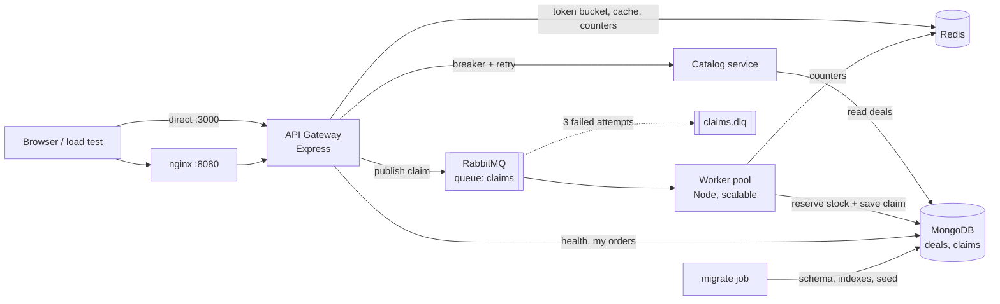
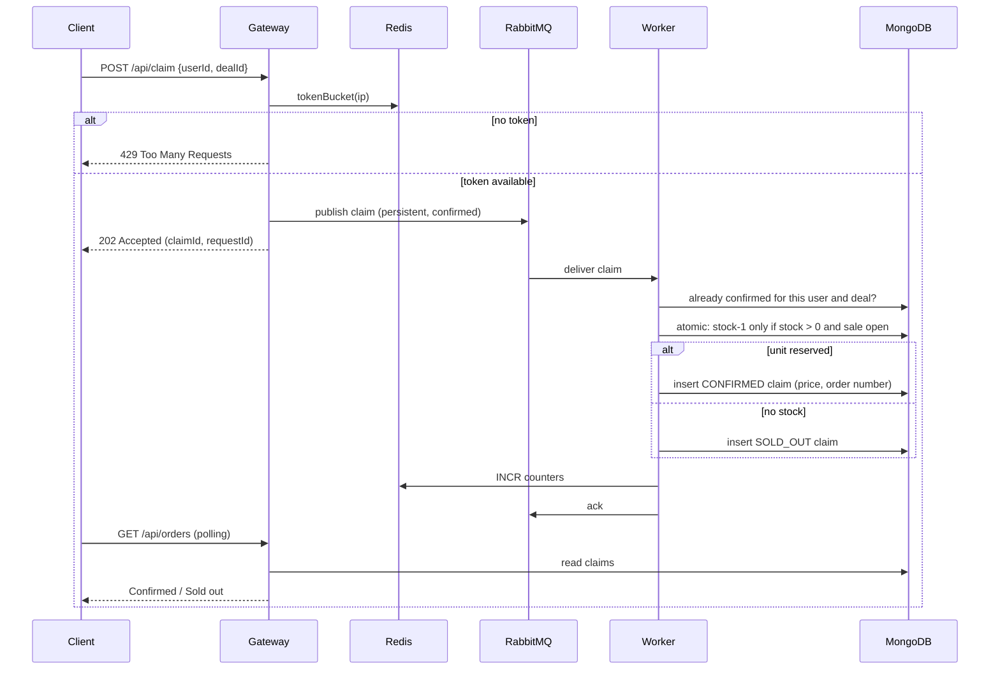
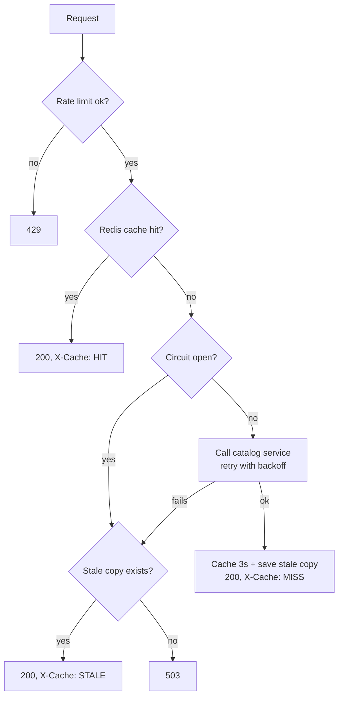

# Architecture and data flow

Mermaid renders on GitHub and at https://mermaid.live (export PNG/SVG for the submission).

## Components

## Data flow: POST /api/claim

## Data flow: GET /api/deals

## Request tracing

Every request gets a `requestId` (header `X-Request-Id`, also saved on the claim and shown in the order receipt).
Each log line is JSON with `service`, `stage` and `requestId`:

`gateway` -> `rate-limiter` -> `gateway->queue` -> `queue->worker` -> `worker->mongodb`

Trace one request: `docker compose logs | grep <requestId>`
